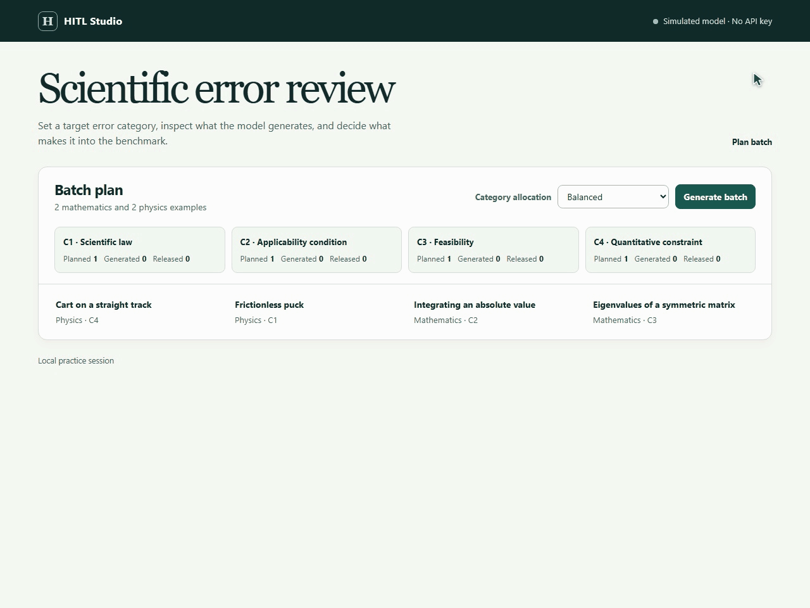

# HITL Benchmark Studio

HITL Benchmark Studio is a simplified public demo of the production Studio used to construct and review scientific hallucination benchmark examples. The production Studio also supports batch import from multiple benchmarks with automatic source asset matching, live model calls for candidate generation, controlled error injection, and annotation revision, a separate review model whose proposed changes go to human adjudication, and resumable processing with persistent review queues and incremental JSONL writes.

A reviewer sets the target error category. The model proposes a candidate and an annotation. The reviewer checks the evidence, controls what can change, and decides whether to release the example.

## Run locally

Requires Python 3.10 or later. From this directory, run:

~~~sh
python server.py
~~~

Open [http://127.0.0.1:8766](http://127.0.0.1:8766). Python's standard library serves both modes locally.

## Replay recorded cases

The home page opens **Recorded cases**. Use **Next step** or the numbered steps to inspect the original model candidate, the reviewer's recorded feedback, the revised candidate and annotation, and the final decision. **Open editable demo** leads to the practice workflow.

The bundled replays draw on the production Studio's saved candidate and annotation versions and the issued dataset. They include two physics cases with controlled regeneration and two mathematics cases with field-level revision. Reviewer feedback originally written in Chinese appears in English translation. The source problems and microscopy image come from [SciBench](https://proceedings.mlr.press/v235/wang24z.html) and [MaCBench](https://macbench.lamalab.org/).

## Try the editable demo

The editable workflow uses two original mathematics examples, two original physics examples, and prepared model replies. It runs without an API key or internet access.

1. Choose **Balanced** or **Quantitative focus** and select **Generate batch**. The plan assigns a target category to each of the four examples.
2. Open **Cart on a straight track**. Its target is **Quantitative constraint**. Compare the candidate against E2. The initial candidate changes the given speed in addition to introducing a unit mismatch. Select **Send back for regeneration**, explain the extra change, and regenerate in the same category.
3. In the replacement, the candidate preserves the given speed. Its annotation still proposes a bad conversion. Select **Request field revision** and give feedback only for **Minimal repair**. For example, ask for 1.5 minutes to be converted to 90 seconds before recomputing the distance.
4. Read the before/after values in **Review history**. The annotation moves from v2 to v3 while the candidate stays at v2. From the sample, select **Review for release**, read the reminders, and choose **Release reviewed sample**.
5. Select **Download reviewed JSONL** to inspect the candidate and annotation histories, review decisions, and cited evidence.

Use **Override annotation** to change the judgment or rewrite individual fields. Leave untouched fields blank. No reason is required. Choose **Reject sample** when it should stay out of the export. The browser session holds progress until you reset the batch or restart the server. Download the record before resetting.

## Implementation

- The demo calculates integer category quotas and runs the review, validation, and versioning logic on the server. Model replies are prepared fixtures. In this mode, written feedback is recorded, and the selected fields control which parts of the prepared reply can be applied.
- **Regeneration** keeps the assigned category while producing a new candidate and annotation. **Selective revision** keeps the candidate and the unselected annotation fields. Both operations leave prior versions available in the review record.
- Structural validation checks the model-provided category label. The release screen reminds the reviewer what to check. The export records the release decision and includes the source evidence for reference.

Run the workflow tests with `python -m unittest -v`.
